# Interactive Operating System Learning & Simulation Platform — Project Documentation

---

## 1. Project Abstract

Operating Systems (OS) form the core foundation of computer science, yet fundamental kernel concepts—such as preemptive CPU scheduling, contiguous memory fragmentation, page replacement policies, deadlock avoidance, disk arm scheduling, and concurrent process synchronization—are inherently dynamic and difficult to grasp from static textbook diagrams alone. Historically, students and instructors rely on fragmented, single-purpose scripts or separate mini-projects to demonstrate each concept individually.

The **Interactive Operating System Learning & Simulation Platform (OSLab Studio)** unifies all six core OS simulation domains and a guided **Learning Mode** into a single full-stack web application. Built with **React.js**, **Tailwind CSS**, **Chart.js**, **Node.js**, **Express.js**, **MongoDB with Mongoose**, and **JWT authentication**, the platform enables learners to configure custom workloads, step through algorithm execution frame-by-frame, compare competing algorithms through live charts, test theoretical knowledge via auto-graded quizzes and practice problems, and persist their experimental history.

---

## 2. Problem Statement

1. **Fragmented Educational Tools**: Students typically build or use six disconnected mini-tools for CPU scheduling, memory allocation, page replacement, Banker's algorithm, disk scheduling, and synchronization, resulting in inconsistent interfaces and duplicated effort.
2. **Lack of Step-by-Step Transparency**: Many online calculators output only final averages (e.g., average waiting time or total seek distance) without revealing intermediate states such as ready-queue transitions, frame evictions, `Work` vector updates, or semaphore values.
3. **Absence of Integrated Assessment**: Existing simulators rarely connect hands-on experimentation with structured theory walkthroughs, quizzes, numerical practice problems, and persistent progress tracking.

---

## 3. Objectives

- **Unified Platform**: Consolidate all six core OS simulation modules into one cohesive, responsive single-page application.
- **Interactive Visualization**: Render proportional Gantt charts, memory block utilization maps, page-frame matrices, disk seek trajectory line plots, and an SVG Dining Philosophers table alongside Chart.js comparative benchmarks.
- **Step-by-Step Playback**: Provide execution traces and interactive sliders/animations so learners can inspect every algorithmic decision.
- **Integrated Learning Mode**: Deliver structured algorithm guides, formulas, auto-graded MCQ quizzes, and verifiable numerical practice problems.
- **Persistence & Security**: Implement user accounts with JWT authentication and Mongoose data models (`User`, `SimulationHistory`, `QuizAttempt`) backed by MongoDB (with graceful in-memory fallback when no local MongoDB daemon is active).

---

## 4. Software & Hardware Requirements

### 4.1 Software Requirements
| Component | Specification |
|---|---|
| Operating System | Windows 10/11, Linux, or macOS |
| Runtime | Node.js v18+ (verified on v22.15.1) & npm 10+ |
| Frontend Stack | React 18, Vite 6, Tailwind CSS 3, Chart.js 4, React Router 7 |
| Backend Stack | Express.js 4, Mongoose 8, JSON Web Tokens (`jsonwebtoken`), `bcryptjs` |
| Database | MongoDB 6+ / MongoDB Atlas (optional in-memory fallback for zero-config demos) |
| Browser | Google Chrome, Microsoft Edge, or Mozilla Firefox |

### 4.2 Hardware Requirements
| Resource | Minimum | Recommended |
|---|---|---|
| Processor | Dual-core 2.0 GHz | Quad-core 2.4 GHz+ |
| RAM | 4 GB | 8 GB+ |
| Disk Space | 500 MB free space | 1 GB+ free space |
| Display | 1280 × 720 | 1440 × 900 or Full HD |

---

## 5. System Architecture

The application follows a decoupled three-tier **Client–API–Database** architecture:

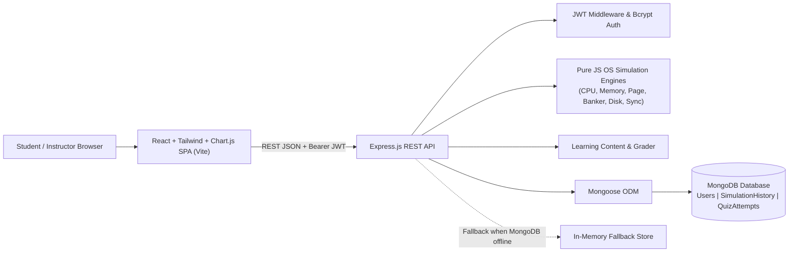

### 5.1 Database Schema (Mongoose ODM)

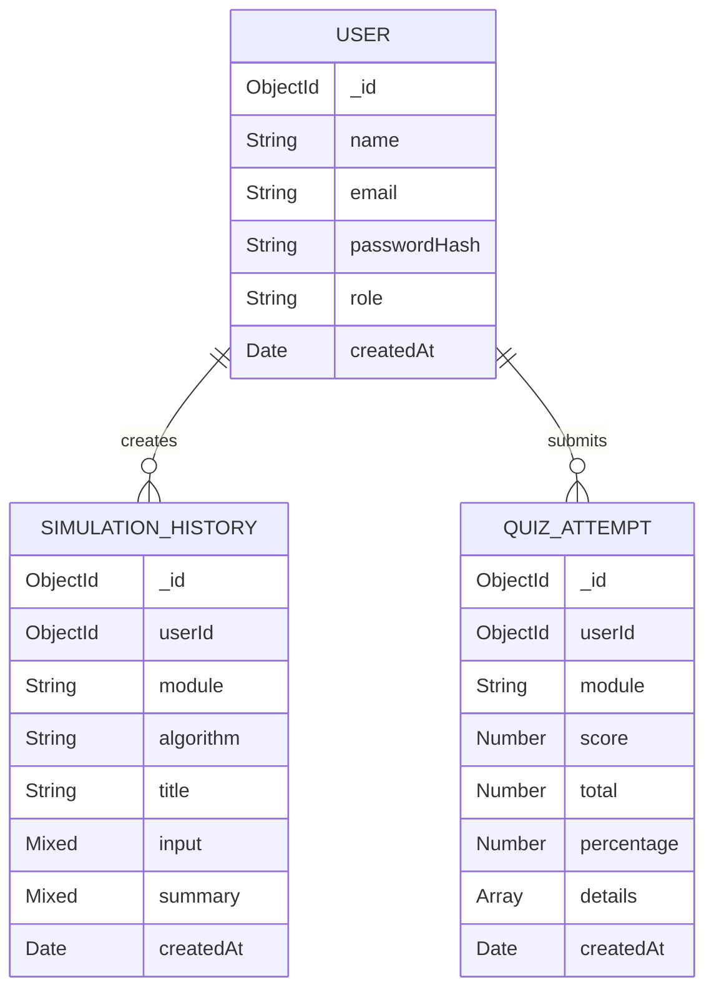

### 5.2 Implementation Roadmap Mapping
1. **Week 1**: UI design, Tailwind theme, React Router layout, Express/Mongoose setup.
2. **Week 2**: CPU Scheduling engines (FCFS, SJF, SRTF, Priority, RR) and dynamic Gantt chart.
3. **Week 3**: Memory Management (First/Best/Worst Fit) and Page Replacement (FIFO, LRU, Optimal).
4. **Week 4**: Deadlock Management using Banker's Algorithm (Safety & Resource Request).
5. **Week 5**: Disk Scheduling (FCFS, SSTF, SCAN, C-SCAN) and Synchronization (Producer-Consumer, Dining Philosophers).
6. **Week 6**: Learning Mode, automated unit & API tests, build optimization, and documentation.

---

## 6. Flowcharts

### 6.1 Overall Platform Request Flow

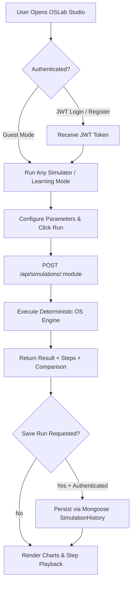

### 6.2 CPU Scheduling Dispatcher Flow

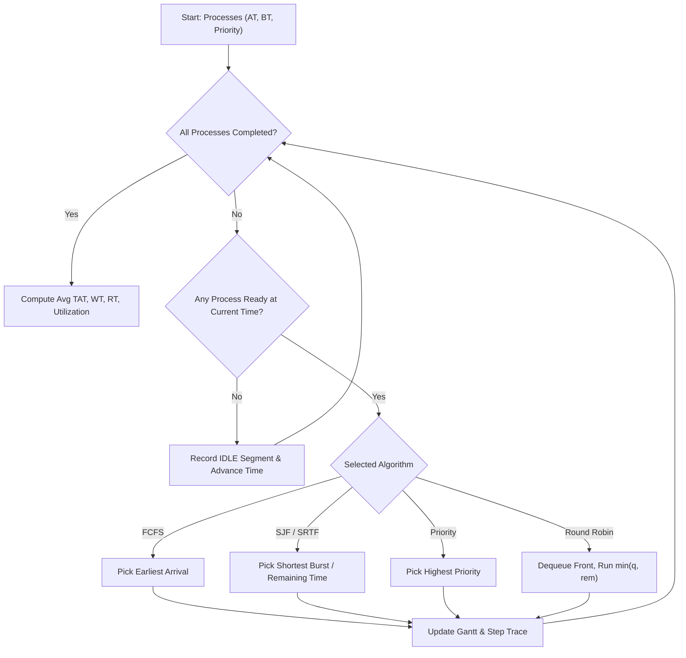

### 6.3 Banker's Algorithm Safety Flow

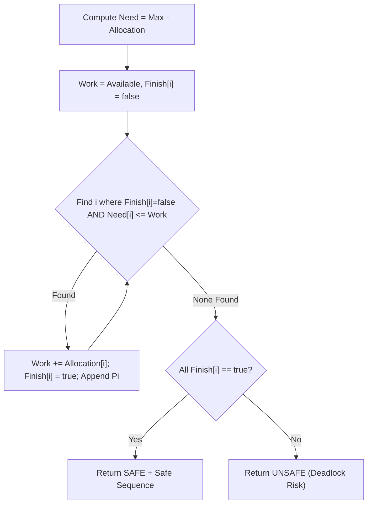

---

## 7. Algorithm Explanations

### 7.1 CPU Scheduling (`server/src/engines/cpuScheduling.js`)
- **FCFS**: Non-preemptive FIFO queue ordered by arrival time. Simple, zero starvation, but prone to the Convoy Effect.
- **SJF**: Non-preemptive selection of the ready process with minimum total burst time.
- **SRTF**: Preemptive variant of SJF evaluated at arrival boundaries; minimizes average waiting time.
- **Priority Scheduling**: Supports both non-preemptive and preemptive modes, with configurable priority ordering.
- **Round Robin**: Preemptive time-sliced scheduling using a FIFO ready queue and configurable quantum `q`.
- **Metrics**: `TAT = CT - AT`, `WT = TAT - BT`, `RT = Start - AT`, `CPU Utilization`, `Throughput`, and `Context Switches`.

### 7.2 Memory Management (`server/src/engines/memoryManagement.js`)
- **First Fit**: Allocates the first free partition large enough (`size >= request`).
- **Best Fit**: Allocates the smallest free partition that fits the request, minimizing internal waste in fixed partitions.
- **Worst Fit**: Allocates the largest available partition, leaving larger remaining holes under variable partitioning.
- Supports both **Fixed Partitioning** (tracks internal fragmentation) and **Variable Partitioning** (splits holes dynamically).

### 7.3 Page Replacement (`server/src/engines/pageReplacement.js`)
- **FIFO**: Evicts the oldest loaded page in memory (demonstrates Belady's Anomaly on `[1,2,3,4,1,2,5,1,2,3,4,5]` with 3 vs 4 frames).
- **LRU**: Evicts the resident page with the oldest last-reference timestamp.
- **Optimal**: Evicts the page referenced farthest in the future (or never again), yielding the theoretical lower bound on page faults.

### 7.4 Deadlock Management (`server/src/engines/deadlockBanker.js`)
- Computes `Need[i][j] = Max[i][j] - Allocation[i][j]`.
- Runs the safety check to find a valid safe execution sequence.
- Supports **Dynamic Resource Request Testing**: verifies `Request <= Need` and `Request <= Available`, tentatively updates state, and grants the request only if the resulting state remains safe.

### 7.5 Disk Scheduling (`server/src/engines/diskScheduling.js`)
- **FCFS**: Services I/O requests strictly in queue order.
- **SSTF**: Greedily selects the closest cylinder to the current head position.
- **SCAN (Elevator)**: Sweeps toward `diskSize - 1` (or `0`), servicing requests along the way, then reverses direction.
- **C-SCAN**: Sweeps in one direction to the boundary, wraps to the opposite boundary, and continues servicing in the same direction for uniform wait times.

### 7.6 Process Synchronization (`server/src/engines/synchronization.js`)
- **Producer-Consumer**: Models bounded buffer slots with `mutex`, `empty`, and `full` semaphores, illustrating blocked producer/consumer transitions when full or empty.
- **Dining Philosophers**: Compares the deadlock-prone **Naive** strategy (circular wait when all grab their left fork) against deadlock-free **Asymmetric** (odd/even fork ordering) and **Waiter** (N−1 arbitrator permits) solutions.

---

## 8. Test Cases

Automated verification covers all 6 simulation engines, Mongoose schema validations, JWT auth endpoints, REST APIs, and the Vite production build (`8/8` test suites passing, `0` failures).
See the complete test matrix in [TEST_CASES.md](TEST_CASES.md).

---

## 9. Screenshots

All screenshots below were captured directly from the live running application (`http://localhost:5000`) via headless Chrome.

### 9.1 Unified Dashboard
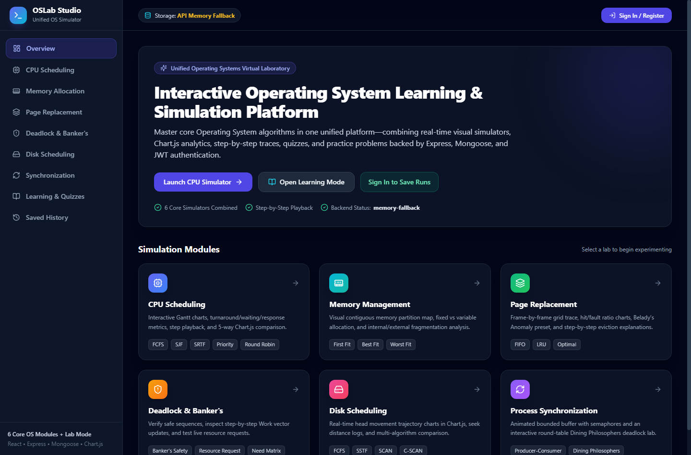

### 9.2 CPU Scheduling Simulator & Gantt Chart
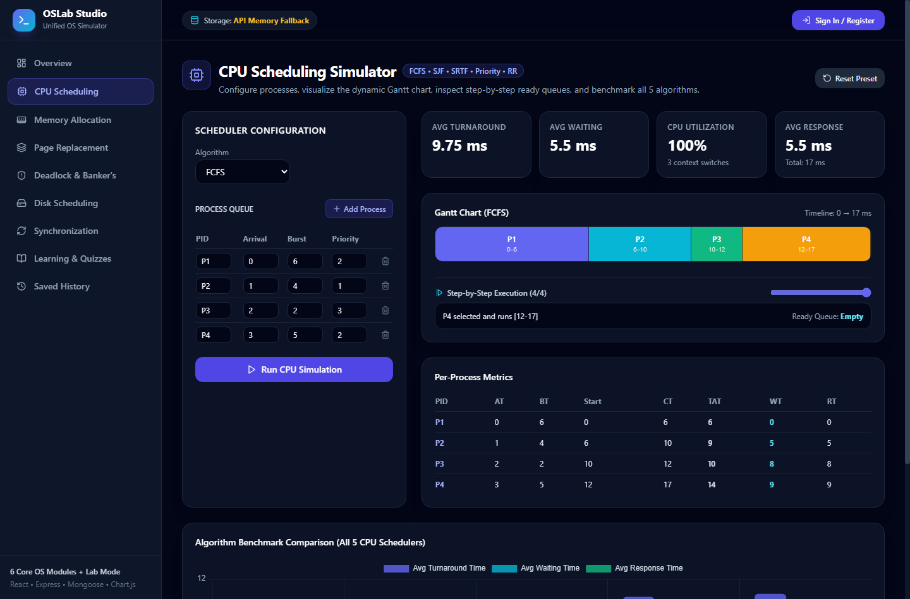

### 9.3 Memory Management Simulator
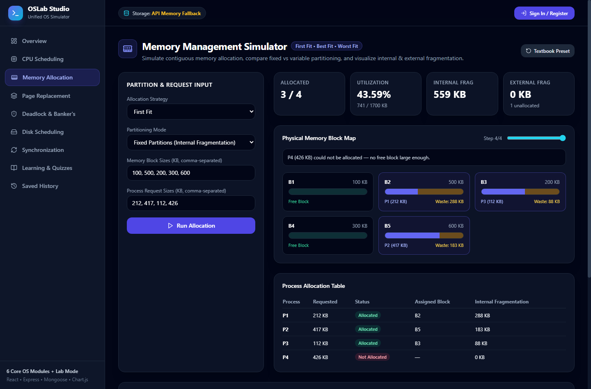

### 9.4 Page Replacement Simulator
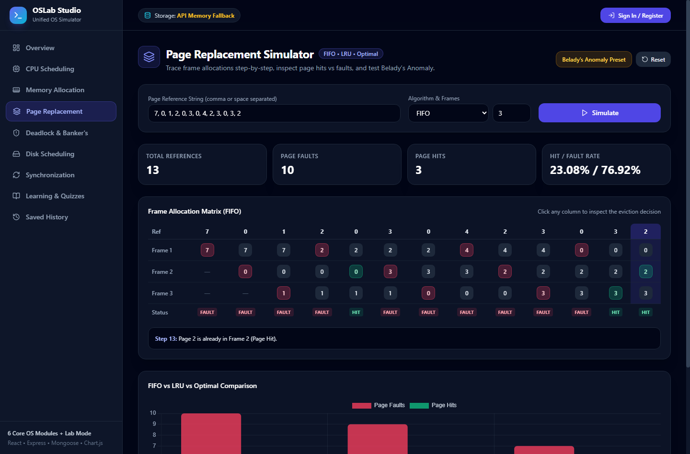

### 9.5 Deadlock Management (Banker's Algorithm)
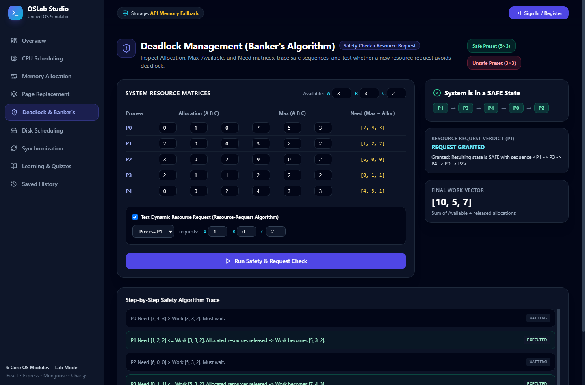

### 9.6 Disk Scheduling Simulator
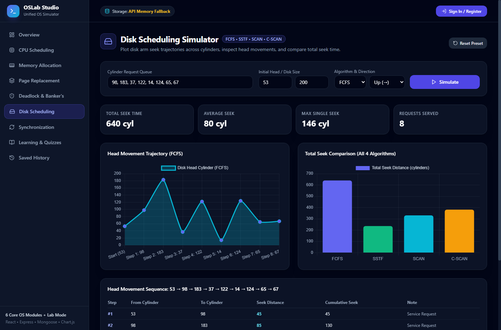

### 9.7 Process Synchronization Lab
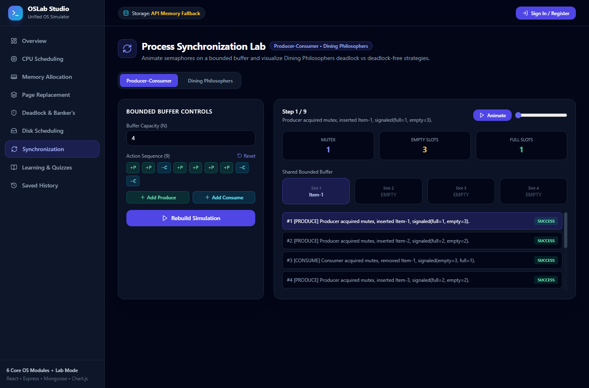

### 9.8 Learning Mode (Guides, Quizzes & Practice)
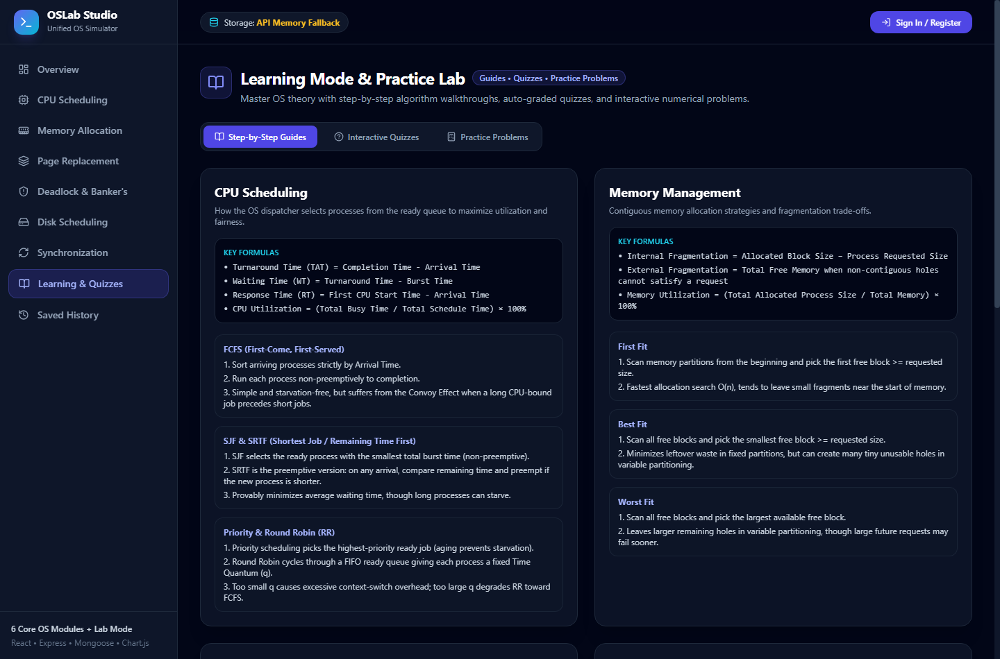

---

## 10. Conclusion and Future Scope

### Conclusion
The **Interactive Operating System Learning & Simulation Platform** successfully consolidates six major Operating System laboratory modules and an interactive Learning Mode into one responsive, full-stack web application. By combining deterministic pure-JavaScript simulation engines, interactive Chart.js analytics, step-by-step playback traces, JWT authentication, and Mongoose persistence, the platform bridges theoretical OS concepts with hands-on visual intuition.

### Future Scope
- **Multi-Level Feedback Queue (MLFQ)** and **CFS (Completely Fair Scheduler)** extensions in the CPU module.
- **Paging + TLB + Segmentation** multilevel address translation simulator.
- **Real-Time Instructor Classroom Mode** using WebSockets (`Socket.io`) for live quiz leaderboards and shared lab presets.
- **PDF Lab Report Export** allowing students to export Gantt charts, matrices, and simulation logs for academic submissions.
